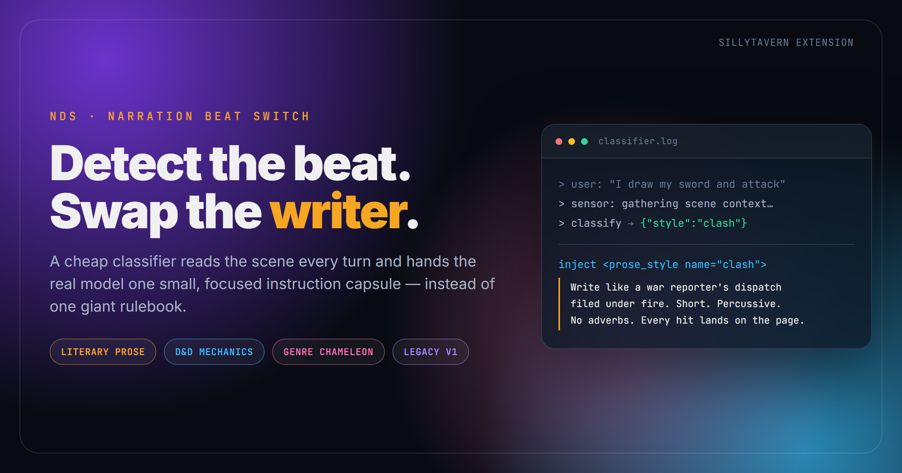
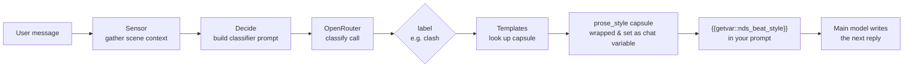
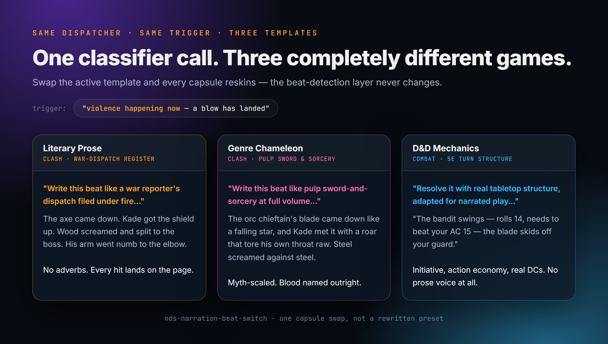
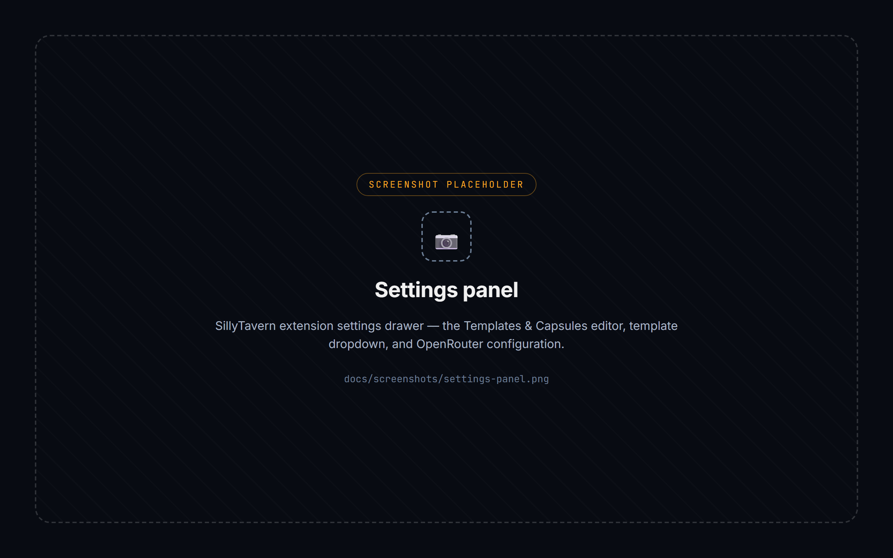
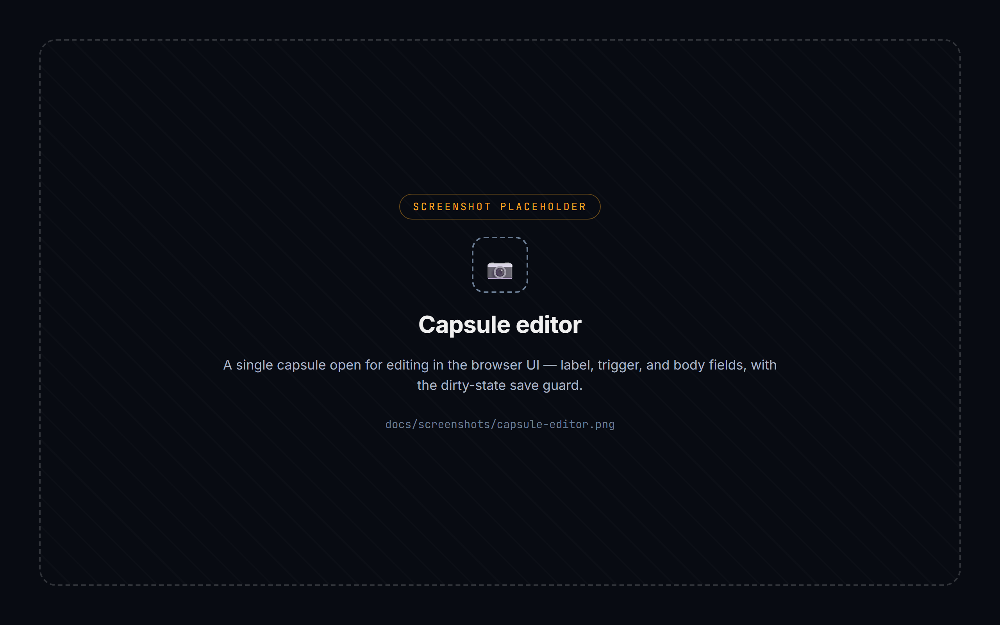

<p align="center">
  
</p>

<p align="center">
  
  
  
</p>

# NDS: Narration Beat Switch

Every scene in a roleplay gets written the same way — because your system prompt is static, and the model has no idea whether it's mid-combat, mid-seduction, or shopping for rope. **NDS reads the beat and swaps the instructions before the real reply is generated.**

A cheap classifier call looks at what just happened, picks one label (`clash`, `court`, `heat`, `combat`, `ledger`, …), and hands the writing model **one small, focused capsule** instead of a giant always-on rulebook. Switch the active *template* and the whole vocabulary changes — restrained literary prose, real 5e mechanics, pulp genre pastiche, whatever you build.

## How it works



The classifier never writes prose — it only picks a label, cheaply and fast (default: 64 max tokens, ~10s timeout). The label resolves to a capsule from whichever **template** is currently active, and that capsule — not the whole library — is what reaches the model doing the actual writing.

## Same trigger, three completely different outputs

<p align="center">
  
</p>

This is the point of the system: the classifier layer is genre- and domain-agnostic. Capsules can carry prose-style instructions, full game mechanics, or anything else — the dispatcher doesn't care.

## Templates

Four factory templates ship out of the box. All are fully editable, and you can add your own from scratch (browser UI or the standalone desktop editor below).

| Template | Labels | What it does |
|---|---|---|
| **Literary Prose** | `clash` `court` `dread` `heat` `ember` `wander` `wire` `ledger` `wound` `levity` `generic` | Grounded literary registers per beat — war-dispatch prose for combat, Shirley-Jackson-style dread, Didion-flat grief, deadpan comedy timing. The refined, general-purpose default. |
| **D&D Mechanics** | `combat` `skill-check` `social-encounter` `exploration` `downtime` `death-and-dying` `treasure-and-rewards` `npc-stats` `generic` | Real 5e-style rules adapted for narrated chat play — action economy, DC ladders, death saving throws, rest mechanics, and a tiered NPC/monster stat lookup so a cheap model can improvise balanced encounters instead of guessing. |
| **Genre Chameleon** | *(same 11 labels as Literary Prose)* | The meta demo — identical beats, wildly different genre lens: noir interrogation for `court`, cosmic horror for `dread`, pulp sword-and-sorcery for `clash`, mock-epic chronicle voice for `ledger`. Proves the classifier is a reusable dispatcher, not a style. |
| **Legacy v1** | *(same 11 labels)* | The original, lighter-touch capsule set — plain field-style instructions (`BEAT:`, `SENTENCES:`, `FORBIDDEN:`) — kept for anyone who prefers the earlier, terser register. |

## Screenshots

> Placeholder images — drop your own captures in at these exact filenames and this section updates automatically, no README edits needed.

| Settings panel | Capsule editor | Desktop editor |
|---|---|---|
|  |  |  |

## Install

1. Copy this repo into your SillyTavern install's third-party extensions folder:
   ```
   <SillyTavern>/public/scripts/extensions/third-party/nds-narration-beat-switch/
   ```
2. Reload SillyTavern and enable **NDS: Narration Beat Switch** from the extensions panel.
3. Add `{{getvar::nds_beat_style}}` somewhere in your prompt (system prompt, author's note — wherever you want the active capsule injected).
4. Open the extension's settings drawer and enter an **OpenRouter API key** — the classifier call requires one. (If you're also running the sibling *NDS: Tracker* extension, NBS can borrow its OpenRouter key/model instead of needing its own.)

That's it — the extension works fully with just that. One thing is optional:

**Disk-synced templates (optional).** If you install the `narrator-tools-storage` SillyTavern server plugin, templates persist to a JSON file on disk (`data/<user>/user/narrator_tools/nbs_templates.json`) instead of just browser-profile settings — this is what lets the standalone desktop editor read and write your templates directly. Without the plugin, everything still works, templates just live in SillyTavern's normal settings instead of syncing to disk.

## Desktop Template Editor

Creating or editing a template entirely through the in-browser form works, but it's not the friendliest way to write a full 9-or-11-capsule template. `tools/` ships a standalone dark-themed desktop app for this instead.

```
tools/NBS Template Editor.bat
```

(Or `python tools/nbs_template_editor.py` directly — Python 3.8+, standard library only, no `pip install` needed.)

It reads and writes the exact same disk file the extension loads at boot, so the workflow is: pick a template from the list (or open any `.txt`/`.md` file, including the factory `library/templates/*.md` sources), edit label / trigger / body per capsule, click **Save**, then reload the SillyTavern tab — your template is live.

## Repo layout

```
index.js                    extension bootstrap
src/                         classifier pipeline (sensor → decide → api → inject), template engine, UI
prompts/                     classifier system-prompt parts (soul, skill, format rules)
library/templates/*.md       factory template sources (plain text, same format the app speaks)
tools/                       standalone desktop template editor
```

## License

MIT — see [LICENSE](LICENSE).
