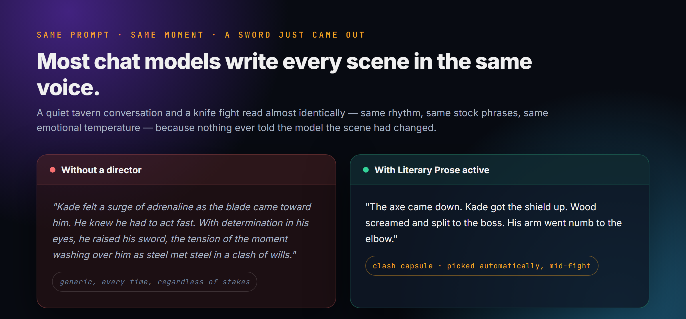
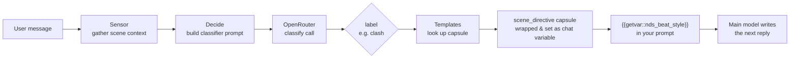

<p align="center">
  
</p>

<p align="center">
  
  
  
</p>

# NDS: Narration Beat Switch

A quiet conversation and a knife fight read almost identically in most SillyTavern chats — same sentence rhythm, same stock phrases, same emotional temperature — because nothing in the prompt ever told the model the scene had changed.

**NDS watches every message, decides what kind of moment just happened, and quietly swaps in a small, focused set of writing instructions before the reply is generated.** You don't toggle anything. You just play, and the prose changes underneath you.

---

## What it actually feels like — Literary Prose

<p align="center">
  
</p>

This is the default template, and it's the one that matters most day to day. Play normally — nothing to learn, nothing to remember to type. But watch what happens as the scene turns:

- You're bargaining with a merchant. The prose is measured, a little wry, dialogue-heavy — the way a good negotiation scene reads.
- A blade comes out. Without you doing anything, the *next* reply lands short, physical, present-tense — no adverbs, no metaphor, sentences that hit like the blows they describe.
- The fight ends and someone tends a wound. The prose drops to a hush — small gestures, unfinished sentences, the kind of quiet a real aftermath scene earns.

None of that is you prompting harder. It's eleven different "registers" — one per kind of beat (combat, negotiation, dread, intimacy, tenderness, exploration, grief, banter, and more) — and a cheap classifier picking the right one, turn by turn, automatically. It's the same thing an attentive human GM does without thinking about it: they *change their voice* for the scene. Literary Prose is what lets SillyTavern do that too.

## A different kind of scene entirely — D&D Mechanics

Literary Prose changes *how* the model writes. Switch the active template to **D&D Mechanics** and it changes *what the model is allowed to do* — because a template isn't a writing style, it's a whole vocabulary of beats and rules.

Normally, running anything like real tabletop combat through a chat model means one of two things: it narrates a fight loosely and nobody's HP means anything, or you spend half the session manually reminding it of the rules. With this template active, drawing a weapon quietly changes the entire mode of play:

> "Initiative: the wolves, then you, then Ser Aldric."
> "The bandit swings — rolls 14, needs to beat your AC 15 — the blade skids off your guard."
> Death saves: 2 successes, 1 failure.

Real action economy, real difficulty classes, a proper death-saving-throw sequence when someone drops to 0 HP instead of the story just deciding they're fine or dead, and a built-in stat lookup so the model can improvise a balanced monster on the spot instead of guessing numbers. Walk away from combat and the next ordinary scene goes right back to plain narration. It's a rules-literate co-DM that only shows up exactly when you need one — for the cost of a couple of dollars a month in classifier calls, not a monthly subscription to a GM-assist product.

## The part that matters — this is one engine wearing different outfits

<p align="center">
  
</p>

Here's the reveal: Literary Prose and D&D Mechanics are not two features. They're two *templates* — two sets of labeled instructions — running through the exact same detection layer. The system doesn't know or care what's inside a capsule; it just reads the scene and hands over whichever block matches.

**Genre Chameleon** proves it by taking the *same eleven beats* as Literary Prose and reskinning every single one into a different genre: the same combat beat that reads like a war dispatch in Literary Prose reads like pulp sword-and-sorcery here. The same negotiation beat becomes a hardboiled noir interrogation. A quiet aftermath scene becomes a fairy tale. Nothing else about your setup changes — you flip one dropdown.

That's the actual idea behind this project: the detector is a small, dumb, reusable dispatcher. What it dispatches *to* can be anything — a writing style, a rules engine, a genre, a tone, a whole different game. Five templates ship in the box (Literary Prose, GM Manual Extended, D&D Mechanics, Genre Chameleon, and the original **Legacy v1** capsule set) and nothing stops you from building your own for your campaign.

## Building your own — no code required

<p align="center">
  
</p>

> Placeholder — drop a real capture in at this exact filename and it updates automatically.

Writing a full template by hand in a browser textarea is unpleasant, so there's a small standalone desktop app for it instead — dark-themed to match, Python only, no installs beyond Python itself.

```
tools/NBS Template Editor.bat
```

Pick an existing template from the list (or open any `.txt`/`.md` file to start from), fill in a **label**, a one-line **trigger** ("when should this apply?"), and a **body** (whatever instructions you want — prose style, game rules, anything) for each beat, click **Save**, reload the SillyTavern tab. Your template is live. That's the entire workflow.

---

## How it actually works, for the curious



The classifier never writes prose — it only picks a label, cheaply and fast (default: 64 max tokens, ~10s timeout). The label resolves to a capsule from whichever template is currently active, and that one capsule — not the whole library — is what reaches the model doing the actual writing.

## Templates reference

| Template | Labels | Register |
|---|---|---|
| **Literary Prose** | `clash` `court` `dread` `heat` `ember` `wander` `wire` `ledger` `wound` `levity` `generic` | Grounded literary craft per beat. The default. |
| **GM Manual Extended** | *(same labels as Literary Prose)* | Same beats, but each capsule injects deep *refereeing* — how the world adjudicates the moment — instead of prose. Swap it in to harden world-logic. |
| **D&D Mechanics** | `combat` `skill-check` `social-encounter` `exploration` `downtime` `death-and-dying` `treasure-and-rewards` `npc-stats` `generic` | Real 5e-adjacent rules adapted for narrated chat play. |
| **Genre Chameleon** | *(same 11 labels as Literary Prose)* | Identical beats, deliberately different genre lens each — the system demo. |
| **Legacy v1** | *(same 11 labels)* | The original, lighter-touch capsule set. |

## Install

1. Copy this repo into your SillyTavern install's third-party extensions folder:
   ```
   <SillyTavern>/public/scripts/extensions/third-party/nds-narration-beat-switch/
   ```
2. Reload SillyTavern and enable **NDS: Narration Beat Switch** from the extensions panel.
3. Add `{{getvar::nds_beat_style}}` somewhere in your prompt (system prompt, author's note — wherever you want the active capsule injected).
4. Open the extension's settings drawer and enter an **OpenRouter API key** — the classifier call requires one. (If you're also running the sibling *NDS: Tracker* extension, NBS can borrow its OpenRouter key/model instead of needing its own.)

That's the whole setup — everything above works with just that. One thing is optional:

**Disk-synced templates.** Install the `narrator-tools-storage` SillyTavern server plugin and templates persist to a JSON file on disk (`data/<user>/user/narrator_tools/nbs_templates.json`) instead of just browser-profile settings — this is what lets the desktop editor read and write your templates directly. Without the plugin, everything still works, templates just live in SillyTavern's normal settings instead of syncing to disk.

## Screenshots

> Placeholder images — drop your own captures in at these exact filenames and this section updates automatically, no README edits needed.

| Settings panel | Capsule editor |
|---|---|
|  |  |

## Repo layout

```
index.js                    extension bootstrap
src/                         classifier pipeline (sensor → decide → api → inject), template engine, UI
prompts/                     classifier system-prompt parts (soul, skill, format rules)
library/templates/*.md       factory template sources (plain text, same format the app speaks)
tools/                       standalone desktop template editor
```

## License

MIT — see [LICENSE](LICENSE).
