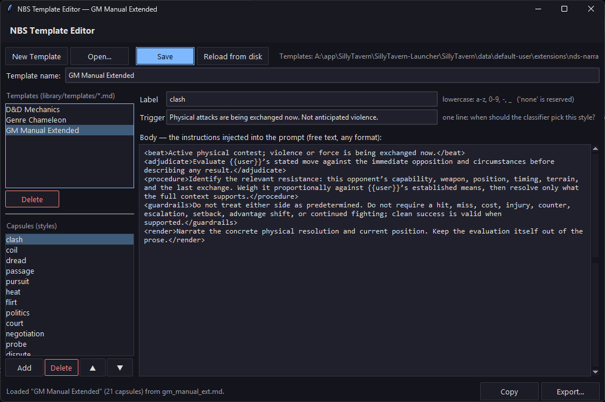

# NDS: Narration Beat Switch

**One beat. One capsule.**

NDS is a lightweight SillyTavern extension that selects one narrow instruction for the current roleplay beat instead of sending a massive all-purpose preset on every reply.

The current user message is treated as a stated, unresolved intention. The previous user/assistant round is secondary context. A small classifier selects one label, and only the matching capsule is injected for the main narrator to resolve.

```text
current user intention + previous round
                  |
           classifier label
                  |
        one matching capsule
                  |
      main narrator resolves it
```

A capsule is a corrective lens, not a predetermined outcome. It can tell the narrator what to evaluate without forcing adversity, cost, escalation, failure, or a choice menu.

## Your templates are plain files

**Every template is a `.md` file in `library/templates/`. One file per template. Those files are the only source of truth.**

They are read fresh from disk every time SillyTavern loads. There is no cache, no copy inside SillyTavern's settings, no seeding and no "factory" template that resists being changed. Edit a file, reload the page, and you are running your version — including the default one.

Three examples ship with the extension. They are examples, not fixtures:

| Template | Capsules | Purpose |
|---|---:|---|
| **GM Manual Extended** | 21 | Per-beat adjudication and narration corrections without predetermined outcomes. Selected first, until you pick another. |
| **D&D Mechanics** | 9 | 5e-adjacent procedures adapted for narrated chat play. |
| **Genre Chameleon** | 11 | A deliberately varied, semi-random genre showcase for the routing system. |

Rewrite any of them, delete the ones you do not want, add your own, and make any template the active one. Nothing here is privileged. The three files above are a starting point and your taste is not required to match anyone else's.

The format is plain text:

```text
# NBS Template: My Template

<capsule label="combat" trigger="a fight is happening">
Any instructions, any format. This is what gets injected.
</capsule>

<capsule label="generic" trigger="anything else">
The fallback, used when no other capsule fits.
</capsule>
```

## Desktop template editor

A standalone editor ships with the extension at `tools/`. It reads and writes the same `.md` files the extension loads — there is no export/import round trip and no hidden storage in between.

**Run it:**

- **Windows** — double-click `tools/NBS Template Editor.bat`
- **Any platform** — `python tools/nbs_template_editor.py`

No installation and no dependencies: it uses only the Python 3.8+ standard library (tkinter). The `.bat` finds `python` or `py` automatically and tells you where to get Python if neither is present.



The editor lets you:

- browse every template in `library/templates/` and open any of them;
- add, delete, rename, and reorder capsules;
- edit each capsule's label, one-line classifier trigger, and instruction body;
- create a new template, or rename an existing one (the old file is removed, not orphaned);
- delete a template, which deletes its file;
- see warnings when a trigger runs long or a capsule body becomes unusually large;
- open or export any template as text, for sharing.

Save writes the `.md` file. Reload SillyTavern (F5) and the change is live.

The extension's own settings panel — **Extensions -> NDS: Narration Beat Switch -> Templates & Capsules** — chooses which template is active and shows what is inside it. It is a viewer: the browser cannot write into the extension folder, so all editing happens in the desktop editor.

## Install from SillyTavern

1. Open **Extensions -> Install Extension**.
2. Paste:

   ```text
   https://github.com/digital-desires/nds-narration-beat-switch
   ```

3. Reload SillyTavern and enable **NDS: Narration Beat Switch**.
4. Open the NBS settings, add an OpenRouter API key, choose a small classifier model, and select an active template.

If the sibling NDS: Tracker extension is installed, NBS can reuse its configured OpenRouter key and model.

## World Setting, Narrative Style, and Presets

These are the same kind of cartridge as a beat template: one `.md` file, loaded from disk.

| Cartridge | Folder | What it governs |
|---|---|---|
| **World Setting** | `library/worlds/` | the world's attitudes, hierarchy, belief, daily life |
| **Narrative Style** | `library/styles/` | how the prose is written |
| **Preset** | `library/presets/` | a named snap of two or three of the above |
| **Beat template** | `library/templates/` | what kind of moment this is |

Add the filename to `library/default_cartridges.js` (worlds / styles / presets) or `library/default_templates.js` (beat templates), then reload SillyTavern.

The settings panel is the editor: the markdown is writable, and each cartridge has **Create**, **Load .md**, **Save**, and **Delete**. The browser cannot write into the extension folder, so your copies live in the extension settings. Shipped files stay on disk unless you Save over them.

Pick them in three places:

1. **Chat start** — a picker the first time that chat has no cartridge record.
2. **NDS: Control → Beat Switch** — four dropdowns on the Beat Switch panel.
3. **Extension settings** — the same four dropdowns, each with the loaded `.md` shown underneath.

A World Setting may include `template: GM Beats` to auto-select a beat template. Changing any filled dropdown after a Preset flips Preset to Custom.

## Use with any existing preset

> Add these variables inside enabled prompt blocks:
>
> - `{{getvar::nds_beat_style}}` — the classified beat capsule
> - `{{getvar::nds_world_setting}}` — the selected World Setting, or empty
> - `{{getvar::nds_narrative_style}}` — the selected Narrative Style, or empty

The extension must be installed and enabled, and one Beat Switch template must be active. Before the main narrator responds, the beat variable expands to the capsule selected for the current turn. World Setting and Narrative Style are session-stable: they change when you pick a cartridge, not every turn. If Beat Switch is disabled, all three variables are empty.

You can keep your preferred completion preset. The bundled GM preset is optional.

## Optional bundled GM preset

The repository includes [`NDS Beat Switch - GM Core V0.3.0.json`](presets/NDS%20Beat%20Switch%20-%20GM%20Core%20V0.3.0.json), a compact GM preset designed around the **GM Manual Extended** Beat Switch template.

1. In SillyTavern, open **AI Response Configuration**.
2. Use the completion-preset menu to import the JSON file.
3. In NBS settings, select **GM Manual Extended** as the active template.

The bundled preset already contains the three `{{getvar::nds_*}}` slots; do not add second copies.

## What is sent

Before each enabled generation, NBS sends one short classifier request through OpenRouter containing:

- the current user message as the primary unresolved intention;
- the immediately preceding user and assistant messages as context;
- the classifier instructions;
- the active template's label and trigger index.

The classifier does not receive every capsule body. The selected capsule enters the normal SillyTavern prompt and is sent to the backend used for the main narration.

NBS includes no telemetry. See [SECURITY.md](SECURITY.md) for details.

## Repository contents

```text
manifest.json               SillyTavern extension manifest
index.js                    extension bootstrap
style.css                   extension interface styles
src/                        classifier, routing, injection, and UI
lib/                        standalone/suite integration
prompts/                    classifier instructions
library/templates/          beat templates — one .md per template
library/worlds/             World Setting cartridges
library/styles/             Narrative Style cartridges
library/presets/            named snaps of two or three cartridges
library/default_templates.js  beat-template filename list
library/default_cartridges.js world / style / preset filename lists
tools/                      desktop template editor (Python, no dependencies)
presets/                    optional shareable completion preset
```

No build step and no server plugin — templates are read straight from `library/templates/`.

## Support NDS

Enjoying the extension? You can help fund more development, testing, and questionable experiments here:

[Support Digital Desires on Ko-fi](https://ko-fi.com/digitaldesires)

## License

MIT - see [LICENSE](LICENSE).
